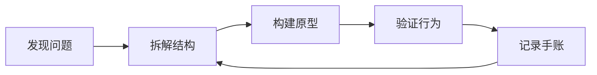

<a id="top"></a>

<picture>
<source media="(prefers-color-scheme: dark)" srcset="https://raw.githubusercontent.com/qilinbro/qilinbro/main/profile/banner-dark.svg" />

</picture>

<p align="center">
<picture>
<source media="(prefers-color-scheme: dark)" srcset="https://raw.githubusercontent.com/qilinbro/qilinbro/main/profile/typing-dark.svg" />

</picture>
</p>

<p align="center"><strong>🌱 Kirin / qilinbro</strong> · Student · Future Full-stack Developer · Mechanical Engineer</p>
<p align="center">把代码、机械结构和好奇心，变成可以看见的作品。</p>

<p align="center">
<a href="#user-content-about">关于我</a> · <a href="#user-content-projects">项目</a> · <a href="#user-content-stack">技术栈</a> · <a href="#user-content-signals">统计</a> · <a href="#user-content-contributions">贡献</a><br />
<a href="#user-content-coding">编程时间</a> · <a href="#user-content-notes">手账</a> · <a href="#user-content-life">代码之外</a> · <a href="#user-content-connect">联系</a>
</p>

<p align="center">
<a href="mailto:qilinxie05@gmail.com"></a>
<a href="https://qilinbro.github.io/"></a>
<a href="https://qm.qq.com/q/PBa9kLBpo6"></a>

</p>

<p align="center">
<a href="https://www.instagram.com/kirenxie/"></a>

<a href="https://www.douyin.com/user/MS4wLjABAAAAljkXghE_MVrQ_LuS8sIMHVW2Ysq53ijNNZAPqfyvF5WY56izdfcCfR3o91V9P5G6?from_tab_name=main"></a>
<a href="https://www.youtube.com/@kirenbro"></a>
</p>

<p align="center">
<a href="https://github.com/qilinbro?tab=followers"></a>
<a href="https://github.com/qilinbro?tab=repositories"></a>

</p>

<p align="center">
<a href="https://github.com/qilinbro/qilinbro/actions/workflows/profile-cards.yml"></a>
<a href="https://github.com/qilinbro/qilinbro/actions/workflows/profile-extras.yml"></a>
</p>

<picture>
<source media="(prefers-color-scheme: dark)" srcset="https://raw.githubusercontent.com/qilinbro/qilinbro/main/profile/overview-dark.svg" />

</picture>

<a id="about"></a>
## 01 / 关于我 · About

<p align="center">

</p>

<h3>🌱 从机械思维，到全栈实践。</h3>
<p>Hi there! I'm Kirin — a student exploring full-stack development and mechanical engineering.</p>
<p>喜欢把抽象的问题拆成结构清楚的小系统：一段代码、一个工具、一张图，或者一个可以不断迭代的个人网站。</p>
<ul>
<li>🔧 关注代码、机械结构、自动化与可视化。</li>
<li>🧪 在真实项目里练习前端、后端与工具设计。</li>
<li>📝 用技术手账和微刊记录学习过程。</li>
<li>🌈 目标：成为优秀的全栈开发者和机械工程师。</li>
</ul>
<p><strong>Learning in public · Keep curiosity alive.</strong></p>

<details>
<summary><strong>🧭 正在探索的方向 / Learning map</strong></summary>

- [x] 个人网站：文章、项目、统计、画廊与友链。
- [x] Python 小工具：图片网格、批量处理与工作流自动化。
- [ ] 持续打磨 React / TypeScript 的全栈项目。
- [ ] 探索社交图谱、可视化与 AI Agent 的结合。
- [ ] 将机械工程的结构思维带到软件设计中。

</details>

<a id="projects"></a>
## 02 / 项目工作台 · Selected projects

<p align="center">
<a href="https://github.com/qilinbro/qilinbro.github.io">
<picture>
<source media="(prefers-color-scheme: dark)" srcset="https://raw.githubusercontent.com/qilinbro/qilinbro/main/profile/pin-website-dark.svg" />

</picture>
</a>
<a href="https://github.com/qilinbro/A2A-Social-graphy-universe">
<picture>
<source media="(prefers-color-scheme: dark)" srcset="https://raw.githubusercontent.com/qilinbro/qilinbro/main/profile/pin-social-dark.svg" />

</picture>
</a>
</p>
<p align="center">
<a href="https://github.com/qilinbro/game-friends">
<picture>
<source media="(prefers-color-scheme: dark)" srcset="https://raw.githubusercontent.com/qilinbro/qilinbro/main/profile/pin-game-dark.svg" />

</picture>
</a>
<a href="https://github.com/qilinbro/image-grid-generator">
<picture>
<source media="(prefers-color-scheme: dark)" srcset="https://raw.githubusercontent.com/qilinbro/qilinbro/main/profile/pin-image-grid-dark.svg" />

</picture>
</a>
</p>

- **[Field Notes](https://qilinbro.github.io/)** — HTML / CSS / JavaScript 个人网站：技术手账、项目、统计、画廊和友链。
- **[Social Graph Universe](https://github.com/qilinbro/A2A-Social-graphy-universe)** — 用星空和力导向布局呈现社交关系，探索 React、D3.js、Node.js、Neo4j 与 AI Agent 的结合。
- **[游戏搭子](https://github.com/qilinbro/game-friends)** — 整合 SecondMe 登录、游戏大厅、房间与 AI 聊天助手的游戏社交原型。
- **[Image Grid Generator](https://github.com/qilinbro/image-grid-generator)** — 将 9 张图片合成 3×3 网格，支持比例、间距、裁剪、质量调整与 PNG / PDF 导出。

<details>
<summary><strong>🗂️ 完整仓库目录 / Repository explorer</strong></summary>

<sub>公开仓库自动整理；Fork 单独标注，点击名称查看源码。</sub>

<!--START_SECTION:catalog-->

**自主仓库**

- [qilinbro](https://github.com/qilinbro/qilinbro) · Mixed / Notes
- [codex-theme-and-pet](https://github.com/qilinbro/codex-theme-and-pet) · Mixed / Notes
- [assignment](https://github.com/qilinbro/assignment) · TypeScript
- [qilinbro.github.io](https://github.com/qilinbro/qilinbro.github.io) · HTML
- [game-friend](https://github.com/qilinbro/game-friend) · TypeScript
- [game-friends](https://github.com/qilinbro/game-friends) · TypeScript
- [social-universe](https://github.com/qilinbro/social-universe) · TypeScript
- [A2A-Social-graphy-universe](https://github.com/qilinbro/A2A-Social-graphy-universe) · JavaScript — 本作品提出一种融合社交图谱（Social Graph）与AI Agent的新型社交平台。传统社交平台多以好友列表或信息流为主要结构，用户难以直观理解自身的社交关系，也难以发现潜在的…
- [employment\_guide](https://github.com/qilinbro/employment_guide) · Python
- [-eight-rules-game](https://github.com/qilinbro/-eight-rules-game) · JavaScript — 清风正道 - 八项规定模拟游戏
- [image-grid-generator](https://github.com/qilinbro/image-grid-generator) · Python — Python图片网格生成器，支持将9张图片合并为一个3x3网格
- [my-own-cloud-repository](https://github.com/qilinbro/my-own-cloud-repository) · HTML
- [helloc](https://github.com/qilinbro/helloc) · C
- [autooperation](https://github.com/qilinbro/autooperation) · Python
- [-CET4-](https://github.com/qilinbro/-CET4-) · Python

**Fork 与开源探索**

- [DouYinSparkFlow](https://github.com/qilinbro/DouYinSparkFlow) · Python — 抖音续火花工具，抖音自动续火花，douyin，支持 GitHub Actions 自动运行（开箱即用的 Workflow 配置）；也可部署至自有服务器，灵活适配个人使用场景
- [atlasapi](https://github.com/qilinbro/atlasapi) · Go — A unified AI model hub for aggregation &amp; distribution. It supports cross-converting variou…
- [PathMind](https://github.com/qilinbro/PathMind) · Python
- [SynHome](https://github.com/qilinbro/SynHome) · Mixed / Notes — 家居设备的高效控制
- [gcxl\_2025](https://github.com/qilinbro/gcxl_2025) · Python — 2025中国大学生工程实践与创新能力大赛
- [ML\_learning](https://github.com/qilinbro/ML_learning) · Mixed / Notes — examing

<!--END_SECTION:catalog-->

</details>

<a id="stack"></a>
## 03 / 技术栈 · Tools & systems

**Languages** · 代码的基本构件

<p></p>

**Frontend** · 网站与交互实验

<p></p>

**Backend / Data** · 项目中实践的系统

<p><br />
<sub>社交图谱：Neo4j · 可视化：D3.js</sub></p>

**Workflow** · 日常开发与自动化

<p></p>

<details>
<summary><strong>🔬 学习与实践笔记 / How I build</strong></summary>



- 从小问题开始，把重复操作做成实用工具。
- 用图形、界面和日志，让算法与系统行为可以被观察。
- 在项目中练习数据建模、交互和自动化，不给自己贴“已精通”的标签。
- 用文档记录过程，也为下一次迭代留下入口。

</details>

<a id="signals"></a>
## 04 / 开发统计 · GitHub signals

<p align="center">
<picture>
<source media="(prefers-color-scheme: dark)" srcset="https://raw.githubusercontent.com/qilinbro/qilinbro/main/profile/stats-dark.svg" />

</picture>
<picture>
<source media="(prefers-color-scheme: dark)" srcset="https://raw.githubusercontent.com/qilinbro/qilinbro/main/profile/streak-dark.svg" />

</picture>
</p>

<p align="center">
<picture>
<source media="(prefers-color-scheme: dark)" srcset="https://raw.githubusercontent.com/qilinbro/qilinbro/main/profile/top-langs-dark.svg" />

</picture>
<picture>
<source media="(prefers-color-scheme: dark)" srcset="https://raw.githubusercontent.com/qilinbro/qilinbro/main/profile/summary-tokyonight/4-productive-time.svg" />

</picture>
</p>

<details open>
<summary><strong>📊 仓库与提交的语言分布 / Language breakdown</strong></summary>

<p align="center">
<picture>
<source media="(prefers-color-scheme: dark)" srcset="https://raw.githubusercontent.com/qilinbro/qilinbro/main/profile/summary-tokyonight/1-repos-per-language.svg" />

</picture>
<picture>
<source media="(prefers-color-scheme: dark)" srcset="https://raw.githubusercontent.com/qilinbro/qilinbro/main/profile/summary-tokyonight/2-most-commit-language.svg" />

</picture>
</p>

</details>

<details>
<summary><strong>🧮 更多统计与成就 / More signals</strong></summary>

<p align="center">
<picture>
<source media="(prefers-color-scheme: dark)" srcset="https://raw.githubusercontent.com/qilinbro/qilinbro/main/profile/summary-tokyonight/3-stats.svg" />

</picture>
</p>

<p align="center">
<a href="https://github.com/qilinbro?achievement=quickdraw&tab=achievements"></a>
<a href="https://github.com/qilinbro?achievement=pull-shark&tab=achievements"></a>
<a href="https://github.com/qilinbro?tab=achievements">查看全部 GitHub 成就</a>
</p>

<sub>代码语言分布反映公开仓库的代码量；WakaTime 图表反映记录到的编程时间，两者统计口径不同。</sub>

</details>

<a id="contributions"></a>
## 05 / 贡献地图 · Contribution atlas

<picture>
<source media="(prefers-color-scheme: dark)" srcset="https://raw.githubusercontent.com/qilinbro/qilinbro/main/profile/summary-tokyonight/0-profile-details.svg" />

</picture>

<details open>
<summary><strong>🏙️ 3D 贡献日历 / Contribution city</strong></summary>

<picture>
<source media="(prefers-color-scheme: dark)" srcset="https://raw.githubusercontent.com/qilinbro/qilinbro/main/profile/3d/profile-night-green.svg" />

</picture>

</details>

<details open>
<summary><strong>🐍 贡献贪吃蛇 / Contribution snake</strong></summary>

<picture>
<source media="(prefers-color-scheme: dark)" srcset="https://raw.githubusercontent.com/qilinbro/qilinbro/output/github-snake-dark.svg" />

</picture>

</details>

<details open>
<summary><strong>⚡ 最近公开动态 / Recent activity</strong></summary>

<!--START_SECTION:activity-->

- `2026-10-15` · 关注项目 · [songconmaisaix31-design/mcpet](https://github.com/songconmaisaix31-design/mcpet)
- `2026-10-11` · 创建 · [qilinbro/codex-theme-and-pet](https://github.com/qilinbro/codex-theme-and-pet)
- `2026-10-10` · 更新代码 · [qilinbro/DouYinSparkFlow](https://github.com/qilinbro/DouYinSparkFlow)
- `2026-10-09` · 更新代码 · [qilinbro/DouYinSparkFlow](https://github.com/qilinbro/DouYinSparkFlow)

<!--END_SECTION:activity-->

<sub>按北京时间整理公开活动；个人简介仓库的自动统计提交不计入此列表。</sub>

</details>

<a id="coding"></a>
## 06 / 编程时间 · Coding telemetry

<picture>
<source media="(prefers-color-scheme: dark)" srcset="https://raw.githubusercontent.com/qilinbro/qilinbro/main/profile/coding-dark.svg" />

</picture>

<details>
<summary><strong>⏱️ WakaTime 公开图表 / Shared charts</strong></summary>


[查看 WakaTime 公开资料](https://wakatime.com/@ec44fecf-e2f0-4f10-b281-af54555dfc52)

</details>

<details>
<summary><strong>💻 原始编程时间明细 / All-time breakdown</strong></summary>

<!--START_SECTION:waka-->

```txt
From: 04 June 2025 - To: 15 October 2026

Total Time: 130 hrs 56 mins

TypeScript   29 hrs 33 mins        🟦🟦🟦🟦🟦🟩⬜⬜⬜⬜⬜⬜⬜⬜⬜⬜⬜⬜⬜⬜⬜⬜⬜⬜⬜   22.58 %
Python       20 hrs 1 min          🟦🟦🟦🟩⬜⬜⬜⬜⬜⬜⬜⬜⬜⬜⬜⬜⬜⬜⬜⬜⬜⬜⬜⬜⬜   15.30 %
Markdown     19 hrs 48 mins        🟦🟦🟦🟩⬜⬜⬜⬜⬜⬜⬜⬜⬜⬜⬜⬜⬜⬜⬜⬜⬜⬜⬜⬜⬜   15.13 %
Other        17 hrs 17 mins        🟦🟦🟦🟨⬜⬜⬜⬜⬜⬜⬜⬜⬜⬜⬜⬜⬜⬜⬜⬜⬜⬜⬜⬜⬜   13.20 %
JSON         7 hrs 2 mins          🟦🟨⬜⬜⬜⬜⬜⬜⬜⬜⬜⬜⬜⬜⬜⬜⬜⬜⬜⬜⬜⬜⬜⬜⬜   05.37 %
CSS          6 hrs 39 mins         🟦🟨⬜⬜⬜⬜⬜⬜⬜⬜⬜⬜⬜⬜⬜⬜⬜⬜⬜⬜⬜⬜⬜⬜⬜   05.08 %
YAML         5 hrs 54 mins         🟦⬜⬜⬜⬜⬜⬜⬜⬜⬜⬜⬜⬜⬜⬜⬜⬜⬜⬜⬜⬜⬜⬜⬜⬜   04.51 %
JavaScript   5 hrs 51 mins         🟦⬜⬜⬜⬜⬜⬜⬜⬜⬜⬜⬜⬜⬜⬜⬜⬜⬜⬜⬜⬜⬜⬜⬜⬜   04.47 %
HTML         4 hrs 39 mins         🟦⬜⬜⬜⬜⬜⬜⬜⬜⬜⬜⬜⬜⬜⬜⬜⬜⬜⬜⬜⬜⬜⬜⬜⬜   03.55 %
SSH Config   3 hrs 46 mins         🟩⬜⬜⬜⬜⬜⬜⬜⬜⬜⬜⬜⬜⬜⬜⬜⬜⬜⬜⬜⬜⬜⬜⬜⬜   02.89 %
```

<!--END_SECTION:waka-->

</details>

<a id="notes"></a>
## 07 / 手账与微刊 · Writing desk

<p align="center">
<a href="weekly/README.md"></a>
<a href="https://qilinbro.github.io/blog.html"></a>
</p>

**技术微刊** — 每周分享优质技术文章、开源项目和实用工具。

<!--START_SECTION:weekly-->

[最新一期：第2期](weekly/2026/issue-2.md) · [全部微刊](weekly/README.md)

<!--END_SECTION:weekly-->

<details open>
<summary><strong>📓 技术手账目录 / Field notes</strong></summary>

<!--START_SECTION:notes-->

- [Building a PyQt6 Zhihu Client](https://qilinbro.github.io/posts/pyqt-zhihu.html)
- [Capturing TOF Camera Data](https://qilinbro.github.io/posts/tof-acquisition.html)
- [Managing Electronic Legal Documents](https://qilinbro.github.io/posts/mcf-manager.html)
- [Visualizing A\* Pathfinding](https://qilinbro.github.io/posts/astar-pathfinding.html)
- [Generating Image Grids with Python](https://qilinbro.github.io/posts/image-grid-generator.html)
- [From Mechanical Engineering to Full-stack](https://qilinbro.github.io/posts/mechanical-to-fullstack.html)
- [Project CitySense：用 AI 唤醒城市脉搏](https://qilinbro.github.io/posts/citysense.html)

<!--END_SECTION:notes-->

</details>

**网站入口**<br />
[Home](https://qilinbro.github.io/) · [Notes](https://qilinbro.github.io/blog.html) · [Projects](https://qilinbro.github.io/projects.html) · [Stats](https://qilinbro.github.io/dashboard.html) · [Gallery](https://qilinbro.github.io/gallery/) · [Neighbors](https://qilinbro.github.io/neighborhood/)

<a id="life"></a>
## 08 / 代码之外 · Life & curiosity

<details open>
<summary><strong>🌟 每日状态 / Daily Status</strong></summary>

☀️ 早上是写代码和上早八的黄金时间～<br />
🎮 下午会玩火影放松（红温）一下<br />
📚 傍晚是学习和思考（色色）的好时光<br />
🌙 深夜最适合 Debug 和肝项目（guitar）了

**🤔 每日发呆24小时 / Daily Daydreaming 24H 🌈**

</details>

<details>
<summary><strong>✨ 关于我的另一面 / Off the keyboard</strong></summary>

- 🎮 游戏爱好者，最爱 Minecraft 和 Genshin Impact。
- 🎧 音乐发烧友，编程时一定要听音乐。
- 🌱 正在学习和成长，永远保持求知欲。
- 💡 热爱编程，享受创造的乐趣。
- 🎯 追求技术进步，也不忘生活平衡。
- 🌈 梦想成为优秀的全栈开发者和机械工程师。

</details>

<a id="connect"></a>
## 09 / 保持联系 · Let's connect

如果你也喜欢代码、机械结构、工具实验或者个人网站，欢迎来交换笔记。

<p align="center">
<a href="mailto:qilinxie05@gmail.com"></a>
<a href="https://qilinbro.github.io/"></a>
<a href="https://qm.qq.com/q/PBa9kLBpo6"></a>

</p>

<p align="center">
<a href="https://www.instagram.com/kirenxie/"></a>

<a href="https://www.douyin.com/user/MS4wLjABAAAAljkXghE_MVrQ_LuS8sIMHVW2Ysq53ijNNZAPqfyvF5WY56izdfcCfR3o91V9P5G6?from_tab_name=main"></a>
<a href="https://www.youtube.com/@kirenbro"></a>
</p>

<details>
<summary><strong>🔗 联系方式文字版 / Contact directory</strong></summary>

- Email：[qilinxie05@gmail.com](mailto:qilinxie05@gmail.com)
- Website：[qilinbro.github.io](https://qilinbro.github.io/)
- QQ：3221565903 · [打开联系入口](https://qm.qq.com/q/PBa9kLBpo6)
- WeChat：kirinbro
- Instagram：[kirenxie](https://www.instagram.com/kirenxie/)
- RedNote：42271875144
- Douyin：35503009597
- YouTube：[kirenbro](https://www.youtube.com/@kirenbro)

</details>

<picture>
<source media="(prefers-color-scheme: dark)" srcset="https://raw.githubusercontent.com/qilinbro/qilinbro/main/profile/footer-dark.svg" />

</picture>

<p align="center"><a href="#user-content-top">↑ 回到顶部</a> · <a href="https://qilinbro.github.io/">进入个人网站</a> · <a href="https://github.com/qilinbro?tab=repositories">探索全部仓库</a></p>

<details>
<summary><sub>展示模块与更新方式 / About this profile</sub></summary>

简介支持明暗主题、页内导航、折叠面板和 SVG 动画。统计卡片、项目卡片、贡献地图与公开动态由 GitHub Actions 定期生成；新图片通过校验后才替换旧图片。WakaTime 原始数据沿用现有自动更新。

数据仅取自公开 GitHub 活动、公开仓库、个人网站与现有 WakaTime 统计。

</details>
